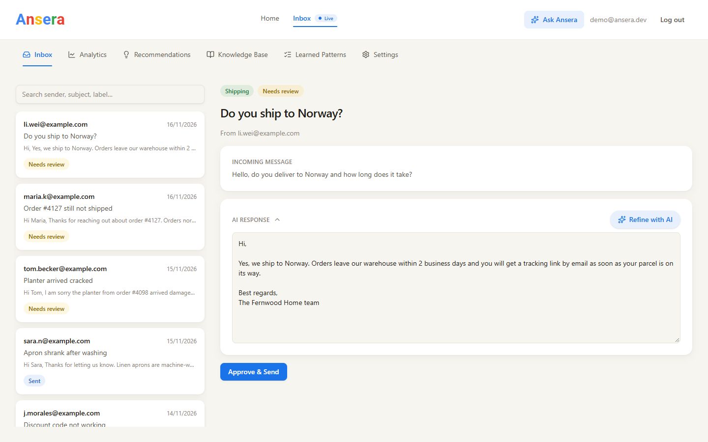
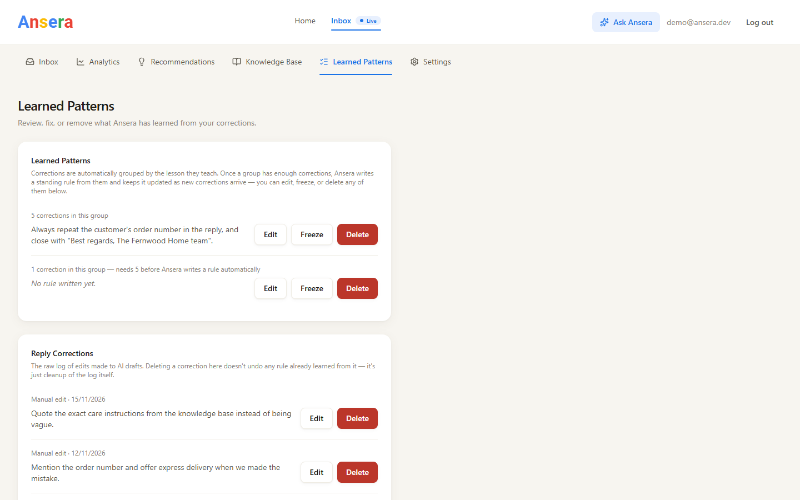
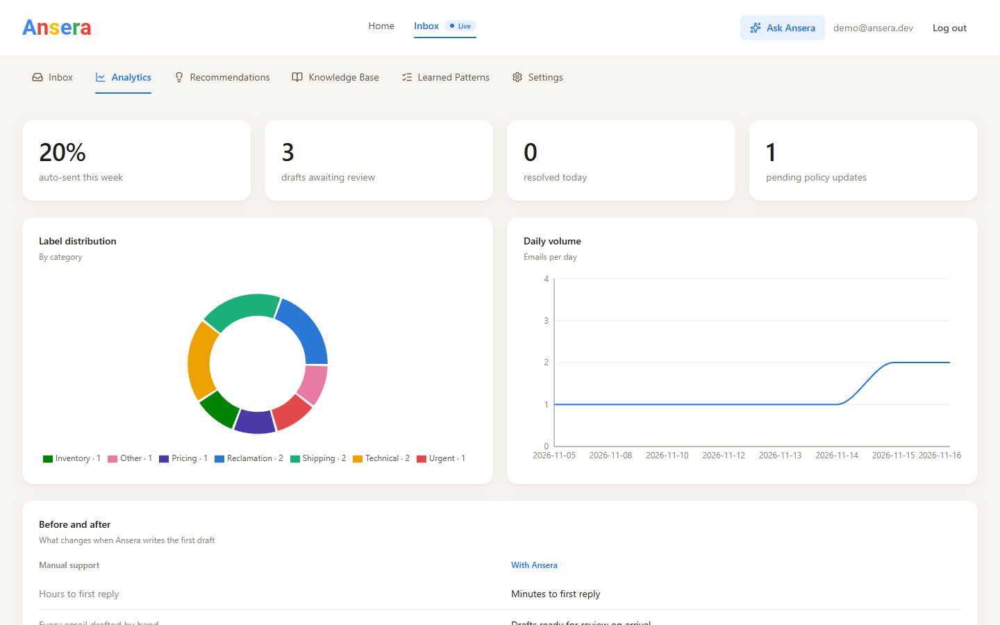
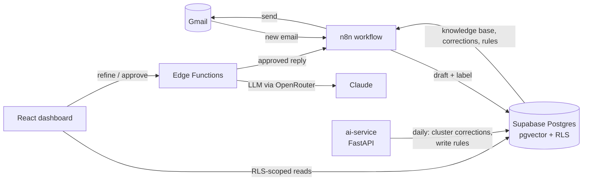

# Ansera — AI customer-support inbox

[](https://github.com/Ceco1223444/ansera/actions/workflows/ci.yml)


Ansera reads a store's support inbox, drafts every reply with an LLM, lets a
person review, refine and approve it, and **learns from every edit**: the
difference between the AI draft and what was actually sent becomes a lesson,
and recurring lessons are condensed into standing rules that shape future
drafts.



## Features

- **AI-drafted replies** grounded in the store's knowledge base (pgvector
  search), the thread history and past corrections.
- **Human in the loop.** Review each draft, edit it, or ask the AI to refine it
  ("shorter", "mention the refund window"), with a prompt-injection guard on
  the refine instruction.
- **Correction learning.** Significant edits are summarised into one-line
  lessons, embedded, de-duplicated (cosine ≥ 0.95), clustered by the lesson
  they teach, and turned into standing rules once five corrections agree. Rules
  stay editable and can be frozen by a person.
- **Auto-send** per store, off by default.
- **Multi-tenant by design.** Postgres row-level security isolates every
  store's emails, corrections and knowledge base.
- **Analytics** (volume, label distribution, auto-send rate) and AI
  recommendations.

| Learned patterns | Analytics |
|---|---|
|  |  |

## Architecture



| Part | Tech | Folder |
|---|---|---|
| Dashboard | React 19, TypeScript, Vite, Tailwind CSS 4, TanStack Query, React Router, Recharts | `src/` |
| Database & API | Supabase: Postgres + pgvector, Auth, RLS, Edge Functions (Deno) | `supabase/` |
| Orchestration | n8n (Gmail trigger, classification, drafting agent, send) | `n8n/` |
| Learning service | Python 3.12, FastAPI, httpx | `ai-service/` |
| Models | Claude via OpenRouter (drafts, refine, rules), OpenAI embeddings | — |

The full design — email flow, the learning maths, the schema, the security
model and every threshold — is in **[docs/architecture.md](docs/architecture.md)**.

## Run it locally

The dashboard runs against a local Supabase stack with demo data, so it needs
no API keys, Gmail account or n8n.

**Prerequisites:** Node.js 20.19+ (or 22.12+), Docker Desktop, and the
[Supabase CLI](https://supabase.com/docs/guides/local-development/cli/getting-started)
(used below through `npx`).

```bash
git clone https://github.com/Ceco1223444/ansera.git
cd ansera
npm ci

# Start Postgres, Auth and the API in Docker; applies all migrations
# and loads the demo data from supabase/seed.sql
npx supabase start

# Point the dashboard at the local stack (writes .env.local)
npx supabase status -o env \
  | sed -n 's/^API_URL=/VITE_SUPABASE_URL=/p; s/^ANON_KEY=/VITE_SUPABASE_ANON_KEY=/p' > .env.local

npm run dev
```

(On Windows without a POSIX shell: copy `.env.example` to `.env.local` and paste
`API_URL` and `ANON_KEY` from `npx supabase status -o env`.)

Open <http://localhost:5173>, click **Log in** and use the demo account:

| Email | Password |
|---|---|
| `demo@ansera.dev` | `ansera-demo` |

Everything that reads or edits data works locally: the inbox, analytics,
knowledge base, learned patterns (edit, freeze, delete), settings and policy
requests. Two actions call outside services and need extra setup:

- **Refine with AI** needs an OpenRouter key: put `OPENROUTER_API_KEY=...` in
  `supabase/functions/.env` and run
  `npx supabase functions serve --env-file supabase/functions/.env`.
- **Approve & Send** hands the reply to the n8n workflow, which sends it with
  Gmail (see [`n8n/README.md`](n8n/README.md)).

To reset the database to the demo state at any time: `npx supabase db reset`.

## Running the full pipeline

| Piece | How |
|---|---|
| Supabase project | `npx supabase link`, then `npx supabase db push` and `npx supabase functions deploy approve-reply refine-reply`; set the function secrets `OPENROUTER_API_KEY`, `N8N_WEBHOOK_URL`, `N8N_WEBHOOK_SECRET` |
| n8n | import the workflow and connect credentials — [`n8n/README.md`](n8n/README.md) |
| ai-service | Docker image with a daily sweep — [`ai-service/README.md`](ai-service/README.md) |
| Local hosting helpers | `scripts/` (Windows): Cloudflare tunnel manager and a status / self-heal service |

## Checks

```bash
npm run lint                         # oxlint
npm run build                        # tsc -b + production build
python ai-service/test_clustering.py # clustering and rule-gate unit tests
npx supabase db reset                # every migration + seed on an empty database
```

GitHub Actions runs all of them on every push.

## Project structure

```
src/                 React dashboard (pages, components, hooks, Supabase client)
supabase/
  migrations/        27 SQL migrations, from the baseline schema onward
  functions/         Edge Functions: approve-reply, refine-reply
  seed.sql           demo store for local development
ai-service/          FastAPI service: clustering, rule writing, daily sweep
n8n/                 exported n8n workflow (credentials stripped)
scripts/             local hosting helpers + n8n export sanitiser
docs/                architecture notes and screenshots
```

## Known limitations

Documented honestly in [docs/architecture.md § Known limitations](docs/architecture.md#10-known-limitations):
the newer cluster rules are not yet wired into the n8n drafting prompt, the
React app and Edge Functions have no automated tests, and n8n plus the
ai-service run on a single machine behind a quick tunnel.

## License

[MIT](LICENSE)
