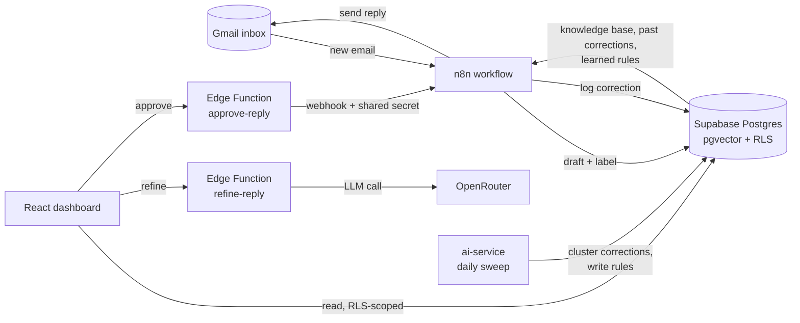

# Architecture

Ansera answers customer-support email. A customer writes to a Gmail inbox; the
system drafts a reply from the store's knowledge base and its own past
corrections; a person reviews, refines and approves it; the reply is sent; and
the difference between the draft and what was actually sent becomes a
*correction* that teaches the system.

## 1. Components

| Component | Runs on | Responsibility |
|---|---|---|
| **React app** (`src/`) | browser (Vite build) | inbox, review / refine / approve, analytics, learned patterns, settings |
| **Supabase** (`supabase/`) | Supabase cloud (or local Docker) | Postgres + pgvector, Auth, row-level security, 2 Edge Functions |
| **n8n workflow** (`n8n/`) | Docker container | Gmail in/out, classification, drafting, database writes — 86 nodes |
| **ai-service** (`ai-service/`) | Docker container (FastAPI) | correction clustering, standing-rule writing, the daily sweep |

All four share one database and otherwise only talk to each other where this
document says so.

## 2. Email flow

### 2.1 Ingestion → draft (n8n)

1. **Gmail Trigger** polls the connected inbox; the message is normalised
   (from / to / subject / text).
2. An LLM chain classifies the intent into exactly one label
   (`Reclamation`, `Shipping`, `Technical`, `Inventory`, `Pricing`, `Urgent`,
   `Other`), in parallel with drafting.
3. The message is embedded (OpenAI `text-embedding-ada-002`, 1536 dims).
4. Context is gathered:
   - knowledge-base passages from `documents` (vector search),
   - the 15 most similar past corrections (`match_reply_corrections()`),
   - the thread history (`thread_messages`, same `thread_id`),
   - the store's learned rules.
5. A code node assembles the prompt context (last 30 thread messages, first 15
   correction notes, the current rules) and an LLM agent writes the draft via
   OpenRouter.
6. The draft is stored in `email_logs` with `status = 'pending_review'`.

### 2.2 Human review (React app)

- **Edit** — the reviewer edits the draft text directly.
- **Refine with AI** — the reviewer types an instruction ("make it shorter",
  "mention the refund window"). The `refine-reply` Edge Function rewrites the
  draft, given both the customer's message and the current draft, and changes
  only what was asked.
  - *Prompt-injection guard:* if the instruction is unrelated to refining a
    support reply, the model must answer `REFUSED: <reason>`, which the function
    turns into `HTTP 422`.
- **Approve & Send** — calls the `approve-reply` Edge Function.

### 2.3 Approve → send → learn

`approve-reply` (`supabase/functions/approve-reply/index.ts`):

1. verifies the caller's JWT, then loads the `email_logs` row with the
   service-role key;
2. **ownership check** — `row.client_email !== user.email` → `403`;
3. **double-send guard** — `row.status !== 'pending_review'` → `409`;
4. writes `final_response` to the row;
5. POSTs to the n8n webhook with an `X-Webhook-Secret` header. The webhook URL is
   read at call time from `public.service_config` (see §8), falling back to the
   `N8N_WEBHOOK_URL` secret.

n8n then checks the secret, sends the email through Gmail, marks the row
`sent`, and compares `ai_response` with `final_response`. If the edit is
significant (normalised Levenshtein similarity below 0.98), an LLM writes a
one-line *lesson* describing what the human changed and why, and the
correction is stored in `reply_corrections`.

### 2.4 Auto-send

`clients.auto_send` is a per-store on/off switch (Settings page). When it is on,
n8n sends the draft immediately and marks it `auto_sent`; when it is off, the
row waits at `pending_review`. There is no confidence score: auto-send is a
deliberate, store-level choice.

## 3. Correction learning

Two layers, deliberately separate.

### 3.1 Per-ticket retrieval

Every new email retrieves its 15 most similar past corrections (cosine
similarity ≥ 0.80 on the message embedding) and injects their notes into the
drafting prompt: specific lessons, fetched only when relevant.

### 3.2 Standing rules

The daily sweep (`ai-service/preferences.py`, scheduled by `main.py`) groups
corrections that teach the *same lesson* and, once a group is large enough,
has the LLM write one standing rule for it. Per store:

1. Skip if `clients.preferences_ai_enabled` is false.
2. **Backfill** `note_embedding` for any correction that has a note but no
   embedding.
3. **Assign to clusters** — each unclustered correction is compared with every
   cluster centroid; the best match at **≥ 0.84** joins that cluster, otherwise
   it starts a new one (`clustering.nearest_cluster_index`, deterministic
   tie-breaking).
4. **Update the centroid** as a running mean (`clustering.running_avg_centroid`).
5. **Write or refresh the rule** when a cluster has **≥ 5 members**, has a
   correction newer than its `rule_written_at` watermark, and is not
   `rule_locked` (`clustering.should_summarize`). Updates show the LLM the
   current rule and ask it to treat its wording as intentional, because a
   person may have edited it.
6. Advance the watermark and record the sweep in `ai_service_schedule`.

The sweep's watermark lives in the database, so a container restart does not
re-run it and a machine that was off overnight catches up immediately.

**Why 0.84.** The threshold is compared against a *centroid*, and averaging
correlated members raises centroid similarity above the pairwise figures. In a
measured run, an unrelated note scored at most 0.795 against any single member
but 0.812 against a 5-member centroid, while same-lesson pairs scored
0.864–0.915. 0.84 sits above the first band and below the second; a regression
test (`test_threshold_is_calibrated_for_centroids`) pins it.

### 3.3 Duplicate prevention

A trigger on `reply_corrections` (`trg_dedupe_reply_correction`) fires after
insert *and* after `note_embedding` is filled in. If another correction for the
same store has a note embedding with cosine similarity ≥ 0.95, the older
duplicate is removed (newest wins). `prune_duplicate_corrections()` and
`report_duplicate_corrections()` expose the same logic manually.

### 3.4 Human control

The Learned Patterns page lists clusters and corrections with edit and delete.
Editing a rule by hand sets `rule_locked = true`, which stops the AI from
rewriting that cluster until it is unlocked.

## 4. Database

Schema history lives in `supabase/migrations/` (27 files) and builds from an
empty database; `supabase/seed.sql` adds a demo store.

### 4.1 Tables

| Table | Holds |
|---|---|
| `clients` | one row per store: `email`, `auto_send`, `learned_patterns_enabled`, `preferences_ai_enabled` |
| `email_logs` | one row per inbound email: message, `ai_response`, `final_response`, `label`, `status` |
| `thread_messages` | conversation history per thread (`direction` in/out) |
| `reply_corrections` | `ai_draft`, `final_sent`, `correction_note`, embeddings, `cluster_id` |
| `correction_clusters` | `centroid`, `member_count`, `rule`, `rule_written_at`, `rule_locked` |
| `learned_patterns` | the earlier single-text rules per store (still read by n8n) |
| `documents` | knowledge base: `content`, `embedding vector(1536)`, `client_email` |
| `ai_recommendations` | per-store suggestions shown on the Recommendations page |
| `policy_requests` | policy changes a store asked for, with a status |
| `ai_service_schedule` | watermark for the daily sweep |
| `service_config` | runtime endpoints (the current n8n webhook URL) — service role only |
| `waitlist_signups` | landing-page sign-ups, insert-only for anonymous visitors |

`email_logs.status` values: `pending_review` (default), `sent`, `auto_sent`.

### 4.2 Functions

| Function | Purpose |
|---|---|
| `match_documents(query_embedding, match_count, filter)` | knowledge-base vector search (used by n8n) |
| `match_reply_corrections(query_embedding, match_client_email, match_count = 15, match_threshold = 0.80)` | per-ticket correction retrieval |
| `get_standing_rules(target_client_email)` | every active cluster rule, largest first; empty when learning is switched off |
| `trg_dedupe_reply_correction()` | 0.95 duplicate guard |
| `prune_duplicate_corrections()` / `report_duplicate_corrections()` | manual dedupe and dry run |
| `report_clusters(client_email)` | cluster inspection for tuning thresholds |
| `prune_learned_patterns(p_keep = 10)` | keeps the newest 10 `learned_patterns` rows |
| `handle_new_user()` | creates the `clients` row on sign-up |
| `sync_documents_client_email()` | keeps `documents.client_email` and its metadata copy in sync |

### 4.3 Security model

- **Multi-tenancy by row-level security.** Every tenant table is scoped with
  `auth.email() = client_email` (`20260709120000_multitenant_rls.sql`), so a
  store can only ever read its own rows. Anonymous visitors have no privileges
  except inserting a waitlist sign-up.
- **Column-level grants.** Stores may update only specific columns of their
  `clients` row (`auto_send` and the two learning switches), not arbitrary
  fields.
- **Writes that matter go through Edge Functions.** The browser never holds a
  service-role key; `approve-reply` and `refine-reply` verify the caller's JWT
  and row ownership before using one.
- **Shared secrets between services**, none of which reaches the browser:

  | Secret | Between |
  |---|---|
  | `N8N_WEBHOOK_SECRET` | `approve-reply` → n8n (`X-Webhook-Secret`) |
  | `AI_SERVICE_SECRET` | n8n / operator → ai-service (`X-Service-Secret`) |
  | `SUPABASE_SERVICE_ROLE_KEY` | Edge Functions, n8n, ai-service → database |

## 5. n8n workflow

`n8n/customer-support-workflow.json` is an export of the production workflow
(86 nodes, one workflow for both the draft path and the send path, which starts
at the `Send Approved Reply (Webhook)` node). Account-specific values are
replaced by placeholders; see `n8n/README.md` for importing it.

## 6. ai-service

FastAPI on Python 3.12. Every endpoint except `/health` requires the
`X-Service-Secret` header.

| Endpoint | Purpose |
|---|---|
| `GET /health` | liveness check |
| `POST /refresh-preferences` | run the clustering + rule sweep for one store |
| `POST /refresh-all-preferences` | the same for every store |
| `POST /generate-reply` | draft a reply with prompt caching and retries (a drop-in for the n8n drafting node) |
| `POST /consolidate-corrections` | the earlier single-pass rule writer, superseded by the sweep |

`claude_client.py` calls Claude **through OpenRouter** (one key, one bill). It
retries transient failures (3 attempts, linear back-off) and returns a `502`
with the reason instead of an empty reply, so n8n can branch on failure rather
than silently dropping a ticket.

## 7. Thresholds and limits

| Value | Purpose | Where |
|---|---|---|
| 0.84 | cluster join (cosine vs centroid) | `ai-service/clustering.py` `CLUSTER_THRESHOLD` |
| 5 | members before a rule is written | `clustering.py` `RULE_THRESHOLD` |
| 0.80 / 15 | per-ticket correction retrieval floor / count | `match_reply_corrections()` defaults |
| 0.95 | duplicate-correction suppression | dedupe trigger and helpers |
| 0.98 | edit-significance gate (smaller edits are not logged) | n8n `Edit Significance Gate` |
| 30 / 15 | thread messages / correction notes in the prompt | n8n `Build Memory Context` |
| 3, 2 s | LLM attempts, linear back-off base | `claude_client.py` |
| 30 s | HTTP timeout for LLM and Supabase calls | ai-service modules |
| 24 h | sweep interval (watermark-anchored) | `main.py` |
| 1536 | embedding dimensions | every `vector(1536)` column |

## 8. Operations

In production n8n and the ai-service run in Docker on one machine; Supabase is
hosted. Two small Windows scripts keep it running unattended:

- `scripts/tunnel-sync.ps1` keeps a Cloudflare quick tunnel pointed at the local
  n8n instance so the hosted `approve-reply` function can reach it. Quick-tunnel
  URLs change several times a day, so on every (re)start the script upserts the
  new URL into `public.service_config`, which `approve-reply` reads at call time.
  It also detects "zombie" tunnels that are running but no longer routing
  traffic, and restarts them.
- `scripts/ops-service.mjs` is a local status / self-heal service (port 5679)
  behind the Settings page's System Status panel: it polls the ai-service health
  endpoint and the Docker containers and can restart a stopped ai-service.

## 9. Testing

| Check | Covers |
|---|---|
| `python ai-service/test_clustering.py` | cosine similarity, running-mean centroid, nearest-cluster selection and tie-breaking, the summarisation gate (size, staleness, lock), the threshold calibration, the pgvector round trip (12 tests) |
| `supabase db start` | all migrations + demo seed apply to an empty database |
| `npm run lint`, `npm run build` | oxlint, TypeScript (`tsc -b`) and the production build |

All three run in GitHub Actions on every push (`.github/workflows/ci.yml`).

## 10. Known limitations

- **Two rule systems coexist.** n8n still reads the older `learned_patterns`
  text; the newer cluster rules are available through `get_standing_rules()` but
  not yet wired into the drafting prompt.
- **`/generate-reply` is built but not wired in.** Drafting still happens in the
  n8n agent node; the endpoint exists to replace it with a cached, retrying call.
- **No automated tests** for the React app, the Edge Functions or the n8n
  workflow; `preferences.py`'s database path is the most complex untested code.
- **No rate limiting** on the Edge Functions or the ai-service, and no retry on
  the `approve-reply` → n8n call (one attempt, then `502`).
- **Single-machine hosting** for n8n and the ai-service, reached through a quick
  tunnel; a production deployment would host both behind a stable URL.
